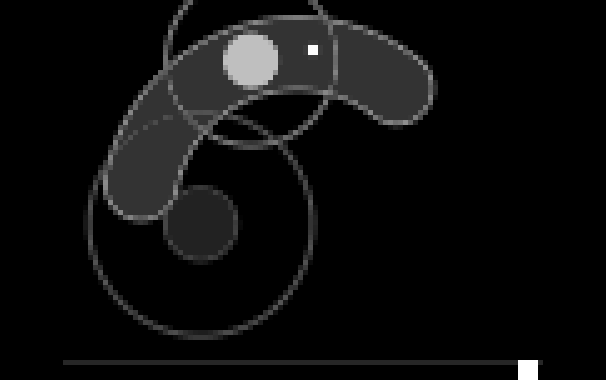

<div align="center">

# OSU_AI

**A reinforcement-learning agent that learns to play osu!standard from pixels alone.**

[](https://www.python.org/)
[](https://pytorch.org/)
[](https://osu.ppy.sh/)
[](LICENSE)

It never sees object coordinates or timings: its only input is a few frames of a **$`96 \times 76`$ grayscale playfield**.<br>
It trains with **Beyond The Rainbow (BTR)**, a modern successor of DeepMind's Atari DQN,<br>
and writes **osu!lazer `.osr` replays** that lazer scores like any other play.

</div>

---

## Preview

<!--
  Both previews show the same play: Unknown Brain - Kuyenda [decently hard] (5.23 stars), 68.5-76.9 s, played by
  round 4 (checkpoints/round4_0-7star/preview.pt). The map is one of round 4's validation maps: it never trained on it.
    python osuai/cli.py render maps/imported/17637eaba7c9268ed0e5b78460bdfe29.osu --gif --start-ms 68500 --seconds 8.4 --upscale 4 --checkpoint checkpoints/round4_0-7star/preview.pt --out docs/preview-agent.gif
    python osuai/cli.py rollout maps/imported/17637eaba7c9268ed0e5b78460bdfe29.osu --checkpoint checkpoints/round4_0-7star/preview.pt
  Import out/17637eaba7c9268ed0e5b78460bdfe29/dqn.osr into osu!lazer and record 1:08.5-1:16.9 as docs/preview-lazer.gif.
-->

<table>
  <tr>
    <th width="50%">What the agent sees</th>
    <th width="50%">The same play in osu!lazer</th>
  </tr>
  <tr>
    <td></td>
    <td></td>
  </tr>
  <tr>
    <td align="center"><sub>The simulated 96×76 frames it plays from (upscaled): approach circles, sliders, a spinner, the cursor and the K1/K2 overlay</sub></td>
    <td align="center"><sub>The replay it wrote, imported into osu!lazer</sub></td>
  </tr>
</table>

<p align="center"><sub><b>Unknown Brain – Kuyenda [decently hard]</b> (5.23★, OD 6.2)</sub></p>

---

## Highlights

- **Pixels in, cursor and keys out.** 30 times a second the agent picks one of 2,160 actions: a cell of a $`24 \times 18`$ aim grid and a key state (none, K1, K2, or K1/K2 half a decision late, for presses on a 17 ms grid).
- **Beyond The Rainbow.** An IMPALA residual encoder with spectral normalization, an implicit-quantile (IQN) head, Munchausen targets, dueling streams, noisy layers and prioritized replay, kept fully convolutional so every aim cell has its own value.
- **Judged by osu!lazer's rules.** A fast simulator/environment judges every tick with lazer's hit windows, note lock, slider tracking and spinner rules. There's also a separate replay judge that scores `.osr` files the way lazer does, with star rating and PP from rosu-pp.
- **Built to grow.** Training runs in rounds of rising star ratings, with held-out validation maps that the agent never trains on, so every score below is on maps it has never seen.

## Results

Accuracy on **held-out validation maps** the agent never trained on, with no exploration (lazer accuracy; $`\mathrm{UR} = 10\,\sigma_{\Delta t}`$, ten times the standard deviation of hit errors in ms).

| Round | Maps | Validation accuracy | UR  | What changed                                                       |
| ----- | ---- | ------------------- | --- | ------------------------------------------------------------------ |
| 1     | 0–3★ | 99.0%               | 175 | first BTR round (99.6% on its training maps)                       |
| 2     | 0–5★ | 97.6%               | 162 | harder maps                                                        |
| 3     | 0–5★ | 99.2%               | 130 | timing bonus, costly key switches, no random actions               |
| 4     | 0–7★ | 99.4%               | 102 | harder maps; all 186 spinners on 0–3★ maps cleared (300s)          |
| 5     | all  | 99.5%               | 105 | every map up to 11★; 10 of 40 validation maps at 100%              |
| 6     | 5★+  | 99.7%               | —   | hard maps only: 6–7★ maps 99.0% → 99.7%, 7★+ maps 98.0% → 99.0%    |

## Contents

- [How it works](#how-it-works)
- [Getting started](#getting-started)
- [Training in rounds](#training-in-rounds)
- [Commands](#commands)
- [Documentation](#documentation)
- [Project structure](#project-structure)
- [Testing](#testing)
- [Acknowledgements](#acknowledgements)

---

## How it works

| Piece            | File              | What it does                                                                                                                                                                                                                                                                                                                                                                                                                                                                                                                                                                                                                                                                                                                                                                                                                                                                          |
| ---------------- | ----------------- | ------------------------------------------------------------------------------------------------------------------------------------------------------------------------------------------------------------------------------------------------------------------------------------------------------------------------------------------------------------------------------------------------------------------------------------------------------------------------------------------------------------------------------------------------------------------------------------------------------------------------------------------------------------------------------------------------------------------------------------------------------------------------------------------------------------------------------------------------------------------------------------- |
| Frame simulator  | `osuai/render.py` | Draws the playfield in grayscale. The cursor is the brightest pixel. Approach circles shrink over the AR preempt. Objects fade in. The slider follow circle appears while a slider is tracked. A spinner fills its whole area, brightening as the required spins are reached, with a ring shrinking over its duration and a line from its centre that turns with the rotation that counts, so it only moves while a key is held. A HUD strip at the bottom shows the K1/K2 overlay.                                                                                                                                                                                                                                                                                                                                                                                                   |
| Game environment | `osuai/env.py`    | Simulates the game at 60 ticks/s of map time and judges online with osu!lazer's rules: its hit windows and note lock, a miss window for early presses (so spam-clicking is punished), slider heads timed like circles, slider ticks, repeats and ends, and spinner rotation. The agent decides every 2 ticks (30 Hz, like the Atari DQN's frame skip). Between decisions the cursor moves straight toward the chosen cell at up to the speed cap, so a nearby cell is reached in the first tick and a far one can take both. Its judging is a fast version of the replay judge, so **scores agree closely but not exactly**.                                                                                                                                                                                                                                                          |
| Agent            | `osuai/dqn.py`    | **Beyond The Rainbow** (BTR, Clark et al. 2024) with **spatial actions** (like DeepMind's StarCraft II agents): a fully convolutional network outputs one value per (grid cell, key state): $`24 \times 18`$ cells $`\times`$ {none, K1, K2, K1 late, K2 late} $`= 2{,}160`$ actions. From BTR: an IMPALA residual encoder with spectral normalization, an implicit quantile (IQN) head that predicts the spread of returns, Munchausen targets, a dueling value/advantage split, noisy layers for exploration, prioritized replay and 3-step returns, plus the target network and stacked frames (4 by default, `--frame-stack`) of DeepMind's Atari DQN. Unlike BTR, the features are not pooled to $`6 \times 6`$ for a fully connected head, so every aim cell keeps its own output. A short horizon ($`\gamma = 0.9`$ per decision) suits the game due to its fast-paced nature. |
| Replay judge     | `osuai/judge.py`  | Scores a replay the way osu!lazer does (see [`judge`](docs/cli.md#judge--score-a-replay)), plus star rating and PP via rosu-pp.                                                                                                                                                                                                                                                                                                                                                                                                                                                                                                                                                                                                                                                                                                                                                                  |

- **What it sees:** a $`96 \times 76`$ px grayscale frame (every pixel goes into the network) with approach circles, hit circles, slider bodies, the slider ball and follow circle, spinners, the cursor and a K1/K2 key overlay.
- **What it does:** 30 times per second it picks **where to aim**, one cell of a $`24 \times 18`$ grid over the playfield, and a key state: no key, K1, K2, or K1/K2 pressed half a decision (17 ms) late. The cursor glides toward that cell at up to 8,000 osu!px/s. Alternating K1/K2 lets it tap on every decision (up to 30 taps/s), like a player streaming.
- **What it learns from:** the game's own judgements (300/100/50/miss, slider ticks and ends, spinner rotation), plus a few shaping terms that make aiming and sliders easier to learn (see the reward below).
- **How it trains:** in rounds on real maps (and optionally synthetic ones made at any star rating), raising the star rating as it improves.

### Reward

Mostly positive, like an Atari score:

| Event                                                                                                                     | Reward                                                                                                                                                                |
| ------------------------------------------------------------------------------------------------------------------------- | --------------------------------------------------------------------------------------------------------------------------------------------------------------------- |
| 300 / 100 / 50 (circles, slider heads, spinners)                                                                          | $`+1.0`$ / $`+0.33`$ / $`+0.17`$                                                                                                                                      |
| 300 on a circle or slider head, by timing                                                                                 | up to $`+0.2`$ more: $`0.2 \cdot \max\left(0,\ 1 - \lvert \Delta t \rvert / w_{300}\right)`$, where $`\Delta t`$ is the hit error and $`w_{300}`$ half the 300 window |
| miss                                                                                                                      | $`-0.1`$                                                                                                                                                              |
| slider tick or repeat hit / missed                                                                                        | $`+0.1`$ / $`-0.02`$                                                                                                                                                  |
| slider end hit                                                                                                            | $`+0.5`$                                                                                                                                                              |
| spinner rotation, paid every tick as the net rotation grows                                                               | $`+0.5`$ per rotation up to the spins a 300 needs, $`+0.1`$ per rotation after; turning back takes it back                                                            |
| slider lost before its end (key let go or cursor out of the follow circle, or a hit head let go before the slider starts) | $`-0.3`$                                                                                                                                                              |
| slider in progress, cursor off the ball's centre                                                                          | $`-1.0 \cdot \min\left(d / r_{\text{follow}},\ 1\right)`$ per second, $`d`$ = distance from the ball                                                                  |
| key press                                                                                                                 | $`-0.03`$, including switching K1 ↔ K2 while holding                                                                                                                  |
| press that hits nothing (no circle or slider head, no slider or spinner going), or a K1 ↔ K2 switch that hits nothing     | another $`-0.1`$                                                                                                                                                      |
| key held while nothing needs one (no slider in progress, no spinner running)                                              | $`-0.2`$ per second                                                                                                                                                   |
| cursor off the next circle or slider head in the last 50 ms before its time (no slider or spinner in progress)            | $`-1.0`$ per second                                                                                                                                                   |

The rewards follow lazer's points (300 for a hit object, 150 for a slider end, 30 for a tick), scaled down. A 100 and a 50 are worth $`\tfrac{1}{3}`$ and $`\tfrac{1}{6}`$ of a 300, the same weights lazer's accuracy uses, so a press one tick off that turns a 300 into a 100 costs two thirds of the hit. Misses cost little, so the occasional hit still stands out while the agent is learning. On top of that, an optional _potential-based_ aim-shaping term, applied per decision,

```math
F(s, s') = \gamma\,\phi(s') - \phi(s), \qquad \phi(s) = -\,\lVert \text{cursor} - \text{target} \rVert
```

(the target is the slider ball while a slider is followed, else the next circle or slider head), speeds up learning without changing the optimal policy. It affects the **reward only**, never what the agent sees. Disable it with `--aim-shaping 0` for a pure game-score reward.

Why each shaping term exists, and how training episodes and map splits work: [design notes](docs/design.md).

---

## Getting started

### Requirements

- **Python 3.10+**, on Windows (for osu!lazer and local play) or Linux (for training)
- A **CUDA GPU**, strongly recommended for training
- **osu!lazer** with some beatmaps installed, to import maps and watch replays

```powershell
pip install -r requirements.txt
```

The default training settings favour what the agent learns over training speed: a round 1 takes about 15 hours on an NVIDIA A10 and several times longer on a laptop GPU. `--channels 64 --depth 3` and a lower `--replay-ratio` train faster.

### Quick start

```powershell
# 1. Import beatmaps from osu!lazer: a beginner pool of every map up to 3 stars
python osuai/cli.py import-lazer --max-stars 3 --limit 0

# 2. Train a first round on them (writes checkpoints/round1_0-3star/)
python osuai/cli.py train --max-stars 3

# 3. Score it on its held-out validation maps
python osuai/cli.py bench --val-only

# 4. Play a map into an osu!lazer replay (out/<map>/dqn.osr), then import it into lazer
python osuai/cli.py rollout maps/imported/<map_md5>.osu

# 5. See what the agent sees
python osuai/cli.py render maps/imported/<map_md5>.osu --gif --checkpoint checkpoints/round1_0-3star
```

> [!TIP]
> **Start with the easiest maps you have.** The agent has to discover aiming and timing from scratch. Begin with a low `--max-stars` cap and raise it round by round (see the [curriculum](docs/training.md#curriculum-continue-training-from-a-checkpoint)).

---

## Training in rounds

Each `train` run is a **round** with its own folder in `checkpoints/`. `--resume` continues from the previous round's weights, so the agent can climb in star rating round by round, keeping the easier maps in the mix:

```powershell
python osuai/cli.py train --max-stars 3                                      # -> checkpoints/round1_0-3star/
python osuai/cli.py train --max-stars 5 --resume checkpoints/round1_0-3star  # -> checkpoints/round2_0-5star/
python osuai/cli.py train --max-stars 7 --resume checkpoints/round2_0-5star  # -> checkpoints/round3_0-7star/
```

- **When to move on:** once accuracy stops rising: `ep_accuracy` in the training log lines and `eval_accuracy` in the evaluations (`log.jsonl` / `round.json`). Hit rate isn't a good signal: it reaches about 0.99 early and says nothing about timing. A round that is going nowhere can be stopped with Ctrl+C; it keeps its checkpoints from the last evaluation.

Checkpoints, evaluations, exploration and the settings fixed after round 1 are covered in the [training guide](docs/training.md).

---

## Commands

All commands are run as `python osuai/cli.py <command> [options]`. Every option is listed in the [CLI reference](docs/cli.md).

| Command                                                                    | What it does                                          |
| -------------------------------------------------------------------------- | ----------------------------------------------------- |
| [`import-lazer`](docs/cli.md#import-lazer--extract-beatmaps-from-osulazer) | Extract beatmaps from your osu!lazer install          |
| [`generate`](docs/cli.md#generate--make-synthetic-maps)                    | Make synthetic maps at any star rating                |
| [`inspect`](docs/cli.md#inspect--inspect-a-beatmap)                        | Print a beatmap's settings, star rating and PP        |
| [`judge`](docs/cli.md#judge--score-a-replay)                               | Score a `.osr` replay the way osu!lazer does          |
| [`bench`](docs/cli.md#bench--accuracy-across-a-map-pool)                   | Accuracy, timing and PP of an agent across a map pool |
| [`train`](docs/cli.md#train--train-the-agent)                              | Train a round                                         |
| [`rollout`](docs/cli.md#rollout--play-maps-into-osr-replays)               | Play maps into osu!lazer replays                      |
| [`render`](docs/cli.md#render--preview-what-the-agent-sees)                | Save what the agent sees as a PNG sheet or GIF        |

---

## Documentation

| Page                               | What's in it                                                                                                                                   |
| ---------------------------------- | ---------------------------------------------------------------------------------------------------------------------------------------------- |
| [Design notes](docs/design.md)     | Why each reward term exists, training episodes and map splits, what the action space is built for                                              |
| [Training guide](docs/training.md) | Rounds and their files, evaluation, the curriculum, exploration, and the round 1 settings: aim grid, press timing, frame history, network size |
| [CLI reference](docs/cli.md)       | All eight commands with every option, map pools, and how the replay judge scores                                                               |

---

## Project structure

```text
OSU_AI/
├── osuai/
│   ├── beatmap.py       # .osu parser: timing/SV inheritance, L/P/B/C sliders, stacking, mods
│   ├── render.py        # grayscale playfield frames (+ PNG contact sheets, animated GIFs)
│   ├── env.py           # step-wise game simulation: the training environment, with online judgement
│   ├── dqn.py           # BTR agent: network, prioritized replay, loss, training loop, map splits, whole-map play
│   ├── judge.py         # replay judge (osu!lazer's rules) + rosu-pp star rating / PP
│   ├── replay.py        # .osr reader/writer in osu!lazer's format (header, LZMA frames, JSON score-info block)
│   ├── synth.py         # synthetic map generator (target star rating, object mix)
│   └── cli.py           # command-line interface
├── tests/               # unit and end-to-end tests
├── docs/                # detailed documentation (design, training, CLI) and the preview GIFs
├── maps/                # beatmaps, one folder per pool, each with its own manifest.json (gitignored)
│   ├── imported/        # maps extracted from osu!lazer by import-lazer (the default pool)
│   └── <name>/          # synthetic maps made by generate --name <name>
├── checkpoints/         # one folder per training round (gitignored)
│   ├── round1_0-3star/
│   │   ├── best.pt      # best checkpoint of the round (by validation reward); used by rollout, bench, render
│   │   ├── last.pt      # latest checkpoint; used by --resume
│   │   ├── log.jsonl    # progress + evaluation log
│   │   └── round.json   # readable summary: round history, settings, maps, results
│   └── round2_0-5star/
└── out/                 # generated replays and previews, one folder per map (gitignored)
    └── <map_folder>/
        ├── dqn.osr
        └── frames.png   # `render` preview (frames.gif with --gif)
```

---

## Testing

```powershell
python -m pytest -v
```

---

## Acknowledgements

- **Beyond The Rainbow** — T. Clark et al., _Beyond The Rainbow: High Performance Deep Reinforcement Learning on a Desktop PC_ (2024), and the methods it combines: IMPALA (Espeholt et al. 2018), IQN (Dabney et al. 2018), Munchausen RL (Vieillard et al. 2020), dueling networks (Wang et al. 2016), noisy networks (Fortunato et al. 2018) and prioritized replay (Schaul et al. 2016).
- **DQN** — Mnih et al., _Human-level control through deep reinforcement learning_ (2015).
- **[osu!](https://osu.ppy.sh/)** and **[osu!lazer](https://github.com/ppy/osu)** by ppy, whose rules the environment and judge follow.
- **[rosu-pp](https://github.com/MaxOhn/rosu-pp)** for star ratings and PP.

This project is not affiliated with or endorsed by ppy Pty Ltd.

## License

[MIT](LICENSE) © 2026 Mason Tran
