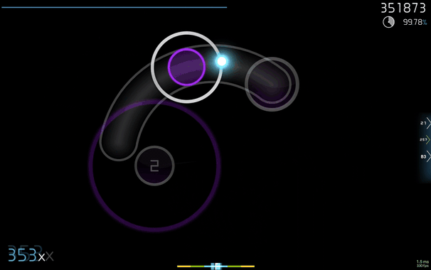

<div align="center">

# OSU_AI

**A reinforcement-learning agent that learns to play osu!standard from pixels alone.**

[](https://www.python.org/)
[](https://pytorch.org/)
[](https://osu.ppy.sh/)
[](LICENSE)

It never sees object coordinates or timings: its only input is a few frames of a **$`96 \times 76`$ grayscale playfield**.<br>
It trains with **Beyond The Rainbow (BTR)**, a modern successor of DeepMind's Atari DQN,<br>
and writes **osu!lazer `.osr` replays** that lazer scores like any other play.

</div>

---

## Preview

<!--
  Both previews show the same play: Unknown Brain - Kuyenda [decently hard] (5.23 stars), 68.5-76.9 s, played by
  round 4 (checkpoints/round4_0-7star/preview.pt). The map is one of round 4's validation maps: it never trained on it.
    python osuai/cli.py render maps/imported/17637eaba7c9268ed0e5b78460bdfe29.osu --gif --start-ms 68500 --seconds 8.4 --upscale 4 --checkpoint checkpoints/round4_0-7star/preview.pt --out docs/preview-agent.gif
    python osuai/cli.py rollout maps/imported/17637eaba7c9268ed0e5b78460bdfe29.osu --checkpoint checkpoints/round4_0-7star/preview.pt
  Import out/17637eaba7c9268ed0e5b78460bdfe29/dqn.osr into osu!lazer and record 1:08.5-1:16.9 as docs/preview-lazer.gif.
-->

<table>
  <tr>
    <th width="50%">What the agent sees</th>
    <th width="50%">The same play in osu!lazer</th>
  </tr>
  <tr>
    <td></td>
    <td></td>
  </tr>
  <tr>
    <td align="center"><sub>The simulated 96×76 frames it plays from (upscaled): approach circles, sliders, a spinner, the cursor and the K1/K2 overlay</sub></td>
    <td align="center"><sub>The replay it wrote, imported into osu!lazer</sub></td>
  </tr>
</table>

<p align="center"><sub><b>Unknown Brain – Kuyenda [decently hard]</b> (5.23★, OD 6.2)</sub></p>

---

## Highlights

- **Pixels in, cursor and keys out.** 30 times a second the agent picks one of 2,160 actions: a cell of a $`24 \times 18`$ aim grid and a key state (none, K1, K2, or K1/K2 half a decision late, for presses on a 17 ms grid).
- **Beyond The Rainbow.** An IMPALA residual encoder with spectral normalization, an implicit-quantile (IQN) head, Munchausen targets, dueling streams, noisy layers and prioritized replay, kept fully convolutional so every aim cell has its own value.
- **Judged by osu!lazer's rules.** A fast simulator/environment judges every tick with lazer's hit windows, note lock, slider tracking and spinner rules. There's also a separate replay judge that scores `.osr` files the way lazer does, with star rating and PP from rosu-pp.
- **Built to grow.** Training runs in rounds of rising star ratings, with held-out validation maps that the agent never trains on, so every score below is on maps it has never seen.

## Results

Accuracy on **held-out validation maps** the agent never trained on, with no exploration (lazer accuracy; $`\mathrm{UR} = 10\,\sigma_{\Delta t}`$, ten times the standard deviation of hit errors in ms).

| Round | Maps | Validation accuracy | UR  | What changed                                                       |
| ----- | ---- | ------------------- | --- | ------------------------------------------------------------------ |
| 1     | 0–3★ | 99.0%               | 175 | first BTR round (99.6% on its training maps)                       |
| 2     | 0–5★ | 97.6%               | 162 | harder maps                                                        |
| 3     | 0–5★ | 99.2%               | 130 | timing bonus, costly key switches, no random actions               |
| 4     | 0–7★ | 99.1%               | 108 | harder maps with 11 of 40 validation maps at 100% (still training) |

## Contents

- [How it works](#how-it-works)
- [Getting started](#getting-started)
- [Training](#training)
- [CLI reference](#cli-reference)
- [Project structure](#project-structure)
- [Testing](#testing)
- [Acknowledgements](#acknowledgements)

---

## How it works

| Piece            | File              | What it does                                                                                                                                                                                                                                                                                                                                                                                                                                                                                                                                                                                                                                                                                                                                                                                                                                                                          |
| ---------------- | ----------------- | ------------------------------------------------------------------------------------------------------------------------------------------------------------------------------------------------------------------------------------------------------------------------------------------------------------------------------------------------------------------------------------------------------------------------------------------------------------------------------------------------------------------------------------------------------------------------------------------------------------------------------------------------------------------------------------------------------------------------------------------------------------------------------------------------------------------------------------------------------------------------------------- |
| Frame simulator  | `osuai/render.py` | Draws the playfield in grayscale. The cursor is the brightest pixel. Approach circles shrink over the AR preempt. Objects fade in. The slider follow circle appears while a slider is tracked. A spinner fills its whole area, brightening as the required spins are reached, with a ring shrinking over its duration and a line from its centre that turns with the rotation that counts, so it only moves while a key is held. A HUD strip at the bottom shows the K1/K2 overlay.                                                                                                                                                                                                                                                                                                                                                                                                   |
| Game environment | `osuai/env.py`    | Simulates the game at 60 ticks/s of map time and judges online with osu!lazer's rules: its hit windows and note lock, a miss window for early presses (so spam-clicking is punished), slider heads timed like circles, slider ticks, repeats and ends, and spinner rotation. The agent decides every 2 ticks (30 Hz, like the Atari DQN's frame skip). Between decisions the cursor moves straight toward the chosen cell at up to the speed cap, so a nearby cell is reached in the first tick and a far one can take both. Its judging is a fast version of the replay judge, so **scores agree closely but not exactly**.                                                                                                                                                                                                                                                          |
| Agent            | `osuai/dqn.py`    | **Beyond The Rainbow** (BTR, Clark et al. 2024) with **spatial actions** (like DeepMind's StarCraft II agents): a fully convolutional network outputs one value per (grid cell, key state): $`24 \times 18`$ cells $`\times`$ {none, K1, K2, K1 late, K2 late} $`= 2{,}160`$ actions. From BTR: an IMPALA residual encoder with spectral normalization, an implicit quantile (IQN) head that predicts the spread of returns, Munchausen targets, a dueling value/advantage split, noisy layers for exploration, prioritized replay and 3-step returns, plus the target network and stacked frames (4 by default, `--frame-stack`) of DeepMind's Atari DQN. Unlike BTR, the features are not pooled to $`6 \times 6`$ for a fully connected head, so every aim cell keeps its own output. A short horizon ($`\gamma = 0.9`$ per decision) suits the game due to its fast-paced nature. |
| Replay judge     | `osuai/judge.py`  | Scores a replay the way osu!lazer does (see [`judge`](#judge--score-a-replay)), plus star rating and PP via rosu-pp.                                                                                                                                                                                                                                                                                                                                                                                                                                                                                                                                                                                                                                                                                                                                                                  |

- **What it sees:** a $`96 \times 76`$ px grayscale frame (every pixel goes into the network) with approach circles, hit circles, slider bodies, the slider ball and follow circle, spinners, the cursor and a K1/K2 key overlay.
- **What it does:** 30 times per second it picks **where to aim**, one cell of a $`24 \times 18`$ grid over the playfield, and a key state: no key, K1, K2, or K1/K2 pressed half a decision (17 ms) late. The cursor glides toward that cell at up to 8,000 osu!px/s. Alternating K1/K2 lets it tap on every decision (up to 30 taps/s), like a player streaming.
- **What it learns from:** the game's own judgements (300/100/50/miss, slider ticks and ends, spinner rotation), plus a few shaping terms that make aiming and sliders easier to learn (see the reward below).
- **How it trains:** in rounds on real maps (and optionally synthetic ones made at any star rating), raising the star rating as it improves.

### Reward

Mostly positive, like an Atari score:

| Event                                                                                                                     | Reward                                                                                                                                                                |
| ------------------------------------------------------------------------------------------------------------------------- | --------------------------------------------------------------------------------------------------------------------------------------------------------------------- |
| 300 / 100 / 50 (circles, slider heads, spinners)                                                                          | $`+1.0`$ / $`+0.33`$ / $`+0.17`$                                                                                                                                      |
| 300 on a circle or slider head, by timing                                                                                 | up to $`+0.2`$ more: $`0.2 \cdot \max\left(0,\ 1 - \lvert \Delta t \rvert / w_{300}\right)`$, where $`\Delta t`$ is the hit error and $`w_{300}`$ half the 300 window |
| miss                                                                                                                      | $`-0.1`$                                                                                                                                                              |
| slider tick or repeat hit / missed                                                                                        | $`+0.1`$ / $`-0.02`$                                                                                                                                                  |
| slider end hit                                                                                                            | $`+0.5`$                                                                                                                                                              |
| spinner rotation, paid every tick as the net rotation grows                                                               | $`+0.5`$ per rotation up to the spins a 300 needs, $`+0.1`$ per rotation after; turning back takes it back                                                            |
| slider lost before its end (key let go or cursor out of the follow circle, or a hit head let go before the slider starts) | $`-0.3`$                                                                                                                                                              |
| slider in progress, cursor off the ball's centre                                                                          | $`-1.0 \cdot \min\left(d / r_{\text{follow}},\ 1\right)`$ per second, $`d`$ = distance from the ball                                                                  |
| key press                                                                                                                 | $`-0.03`$, including switching K1 ↔ K2 while holding                                                                                                                  |
| press that hits nothing (no circle or slider head, no slider or spinner going), or a K1 ↔ K2 switch that hits nothing     | another $`-0.1`$                                                                                                                                                      |
| key held while nothing needs one (no slider in progress, no spinner running)                                              | $`-0.2`$ per second                                                                                                                                                   |

The rewards follow lazer's points (300 for a hit object, 150 for a slider end, 30 for a tick), scaled down. A 100 and a 50 are worth $`\tfrac{1}{3}`$ and $`\tfrac{1}{6}`$ of a 300, the same weights lazer's accuracy uses, so a press one tick off that turns a 300 into a 100 costs two thirds of the hit. Misses cost little, so the occasional hit still stands out while the agent is learning. On top of that, an optional _potential-based_ aim-shaping term, applied per decision,

```math
F(s, s') = \gamma\,\phi(s') - \phi(s), \qquad \phi(s) = -\,\lVert \text{cursor} - \text{target} \rVert
```

(the target is the slider ball while a slider is followed, else the next circle or slider head), speeds up learning without changing the optimal policy. It affects the **reward only**, never what the agent sees. Disable it with `--aim-shaping 0` for a pure game-score reward.

<details>
<summary><b>Why each shaping term exists</b></summary>

<br>

These terms make the hard parts visible sooner. With $`\gamma = 0.9`$ per decision the agent looks only about $`1/(1-\gamma) = 10`$ decisions (a third of a second) ahead, so a reward much later than that barely registers:

- **Spinners:** a spinner's grade only comes at its end, often 100+ decisions away. So rotation is paid as it happens, by how much the net rotation grew this tick (back-and-forth earns nothing). The radius doesn't matter: the cursor reaches one grid cell per decision in a straight line, which sweeps under $`180^\circ`$ around the centre, and anything from about 30 to 130 px allows several times the spins any map needs. Huge turns are a gamble, though: a jump of nearly $`180^\circ`$ passes close to the centre, and a small aiming error flips it into a full turn backwards. `--spin-max-deg` can cap the forward rotation the reward credits per tick, but it's off by default because it stops spinning from being learned at all. Uncapped, an untrained agent that holds a key and moves at random still earns a little on average (about $`+0.9`$ over a 3 s spinner), because the net rotation drifts away from zero, and that draws it into spinning. Capped at $`60^\circ`$, the same random movement loses reward (about $`-0.5`$), because forward turns are cut while turning back is charged in full. A round 1 trained with the cap learned never to hold a key during spinners and cleared none of them.
- **Slider breaks:** losing a slider otherwise costs nothing until the next tick is missed, and combo isn't in the reward at all. The break penalty lands on the tick the slider is lost: the key was let go (choosing "none" or a late key, which lifts the key for its first tick) or the cursor left the follow circle. It also covers a slider that was never held: a head tapped early and let go before the slider starts. Without that, tapping a slider like a circle cost only the missed ticks and end, less than holding and slipping, and a BTR round 1 learned never to hold sliders (8% of them tracked, 76% accuracy). Holding a key from an early head until its slider starts is not an idle hold.
- **Hits are paid at the object's time:** with $`\gamma = 0.9`$, a reward one decision (33 ms) sooner is worth $`1/\gamma \approx 1.11`$ times as much. Paying a hit on the press made pressing early pay in itself, so presses drifted to the early edge of the 300 window (on average 26 ms early, with 99% of non-300 hits early), and the spread then pushed some of them over the edge into 100s. So a hit made before its object's time is paid when that time comes, the same moment as a perfectly timed press, and the only thing early pressing changes is the risk of a 100. Late hits are paid on the press as before. `--no-pay-hits-on-time` pays every hit on the press.
- **Timing inside the 300 window:** every press inside the window used to pay the same, so nothing pulled presses toward its centre. A round 2 agent hit with a 16–17 ms spread, a little late on average, and on OD 8 maps (a $`\pm 32`$ ms window) most of its lost accuracy was 100s. The timing bonus pays up to 0.2 more for a 300 pressed exactly on time, nothing at the window's edge, so presses keep a margin, which high-OD maps need.
- **Key presses and idle holds:** holding a key would otherwise be free, and an agent that always holds one "presses" by switching between K1 and K2. Holding K1 and holding K2 look equally good to it, so it flips between them almost at random, and a flip with the cursor over a circle that isn't due yet hits it too early, which is a miss. A press costs 0.03, switches included, and holding a key while nothing needs it costs 0.2 per second. A press that hits nothing costs another 0.1: no circle or slider head, no slider in progress, no spinner running or about to start. Without it the agent got into the habit of pressing again about 67 ms after half of its hits; usually that hit nothing, but when the cursor was already on the next object, or that object was stacked on the same spot, the extra press hit it a beat early, which is a miss. That's next to nothing during a fast stream, where alternating keys keeps one down, but a second of idle holding costs as much as 7 presses. A switch from one key to the other while holding costs the extra 0.1 too when it hits nothing, even during a slider or spinner, where the held key already counts: without that, a round 2 agent switched keys mid-slider on 26% of its presses, and switches into stacked notes caused half its early misses.
- **Slider offset:** after a release, tracking restarts only with the cursor on the ball itself ($`1\times`$ its radius, not the $`2.4\times`$ follow circle), so drifting toward the follow circle's edge turns a brief release into a lost slider. A small per-tick cost for distance from the ball keeps a margin.

The slider and key terms are not potential-based. They do change the best policy, on purpose: they value keeping combo and a safety margin more than the game score alone does.

</details>

### Episodes and map splits

- **Training episodes** are random 30-second windows of random training maps, with the cursor starting at a random position. During training, breaks longer than 1 s are fast-forwarded once everything before them has been judged. When the agent plays a whole map (`rollout`, `bench`, `render`, and the evaluations during training), it plays through breaks in real time, so its replays cover the whole song.
- **Training and validation maps** are split by a hash of each map's MD5, so every map has a permanent role whatever star filter a round uses. When resuming, any map trained on in an earlier round stays a training map, and validation maps stay held out unless they were trained on at some point. Validation scores therefore never include maps the agent has seen. Every checkpoint records both lists across all rounds.

> [!NOTE]
> **Built for hard maps.** The action space covers what 8–11★ maps demand, e.g. Galaxy Collapse 11★: CS 4.5, OD 9.2, jumps up to ~6,100 px/s, 20-taps/s streams.
>
> | Demand        | Hardest maps                       | Design                                                                  |
> | ------------- | ---------------------------------- | ----------------------------------------------------------------------- |
> | Aim precision | circle radius 34–36 px             | grid cells 21 px, worst-case error ~15 px (finer with `--grid`)         |
> | Cursor speed  | up to ~6,300 px/s                  | cap 8,000 px/s                                                          |
> | Tap rate      | up to 20 taps/s                    | up to 30 taps/s by alternating K1/K2                                    |
> | Timing        | 300 window $`\pm 23\text{–}25`$ ms | decisions every 33 ms, presses on a 17 ms grid: best press within ~8 ms |
>
> This means nothing _prevents_ 11★ play. Whether the agent _learns_ it is another matter, and every step up in difficulty needs much more training.

---

## Getting started

### Requirements

- **Python 3.10+**, on Windows (for osu!lazer and local play) or Linux (for training)
- A **CUDA GPU**, strongly recommended for training
- **osu!lazer** with some beatmaps installed, to import maps and watch replays

```powershell
pip install -r requirements.txt
```

The default training settings favour what the agent learns over training speed: a round 1 takes about 15 hours on an NVIDIA A10 and several times longer on a laptop GPU. `--channels 64 --depth 3` and a lower `--replay-ratio` train faster.

### Quick start

```powershell
# 1. Import beatmaps from osu!lazer: a beginner pool of every map up to 3 stars
python osuai/cli.py import-lazer --max-stars 3 --limit 0

# 2. Train a first round on them (writes checkpoints/round1_0-3star/)
python osuai/cli.py train --max-stars 3

# 3. Score it on its held-out validation maps
python osuai/cli.py bench --val-only

# 4. Play a map into an osu!lazer replay (out/<map>/dqn.osr), then import it into lazer
python osuai/cli.py rollout maps/imported/<map_md5>.osu

# 5. See what the agent sees
python osuai/cli.py render maps/imported/<map_md5>.osu --gif --checkpoint checkpoints/round1_0-3star
```

> [!TIP]
> **Start with the easiest maps you have.** The agent has to discover aiming and timing from scratch. Begin with a low `--max-stars` cap and raise it round by round (see the [curriculum](#curriculum-continue-training-from-a-checkpoint)).

---

## Training

Each `train` run (a **round**) writes into its own folder, by default `checkpoints/round<N>_<stars>` (e.g. `round1_0-3star`, `round2_0-4star`, `round1_allstars`):

| File         | Contents                                                                                                                                                               |
| ------------ | ---------------------------------------------------------------------------------------------------------------------------------------------------------------------- |
| `best.pt`    | Best checkpoint of the round by validation reward. Passing a round folder to `--checkpoint` (`rollout`, `bench`, `render`) uses this one.                              |
| `last.pt`    | Latest checkpoint, saved at every evaluation. Passing a round folder to `--resume` continues from this one.                                                            |
| `log.jsonl`  | One JSON line per progress log (steps/s, $`\varepsilon`$, episode reward / accuracy / hit rate, loss, mean Q) and per evaluation.                                      |
| `round.json` | Readable summary: status, step counts, best and latest evaluation, the round history, settings and this round's training/validation maps. Updated while training runs. |

`train` refuses to write into a folder that already holds a round. Pass `--force` to replace one on purpose. Anywhere a checkpoint is expected (`--resume`, `--checkpoint`), you can pass a round folder or a specific `.pt` file.

### Evaluation

Every `--eval-interval` decisions, and at the end of the round, the agent plays the first 60 s of `--eval-maps` validation maps (12 by default) without exploration. The results are logged as `eval_*`. They decide `best.pt` (by `eval_reward`) and are when `last.pt` is saved. They don't affect learning.

- **Which maps:** the round's eval maps are spread evenly over the star range of its validation pool, from the easiest to the hardest. Each round's set is saved in its checkpoint and listed in `round.json` (`eval_maps`).
- **Comparing rounds:** a later round's eval maps are harder, so its `eval_accuracy` is lower even when the agent improved. Each evaluation therefore also replays the previous round's eval maps, logged as `eval_prev_*` (listed as `prev_eval_maps` in `round.json`). Compare a round's `eval_prev_accuracy` with the previous round's final `eval_accuracy`: that's the same maps, before and after this round's training.
- **Cost:** a few seconds per map, so one evaluation with both sets takes about a minute, a few percent of the training time.

### Curriculum: continue training from a checkpoint

`--resume <checkpoint>` continues from a checkpoint's network weights and Adam optimizer state on whatever maps you select. That lets you train in rounds of increasing difficulty:

```powershell
python osuai/cli.py train --max-stars 3                                      # -> checkpoints/round1_0-3star/
python osuai/cli.py train --max-stars 5 --resume checkpoints/round1_0-3star  # -> checkpoints/round2_0-5star/
python osuai/cli.py train --max-stars 7 --resume checkpoints/round2_0-5star  # -> checkpoints/round3_0-7star/
```

- **When to move on:** once accuracy stops rising: `ep_accuracy` in the training log lines and `eval_accuracy` in the evaluations (`log.jsonl` / `round.json`). Hit rate isn't a good signal: it reaches about 0.99 early and says nothing about timing. A round that is going nowhere can be stopped with Ctrl+C; it keeps its checkpoints from the last evaluation.
- **Which checkpoint to resume:** a round folder resumes from its `last.pt`, the weights with the most training. `best.pt` is picked by a short evaluation and can be a lucky spike. If a round clearly got worse towards its end (training `ep_accuracy` falling for several log lines), resume from `checkpoints/<round>/best.pt` instead. When unsure, compare both with `bench --val-only`.
- **Resume from the latest round:** each checkpoint carries the training/validation roles of all rounds before it. Resume each round from the one before it, and older round folders can be deleted once the new round has saved its first checkpoint.
- **Round numbers:** the round number comes from the checkpoint's history, so the next folder is named automatically. Use `--out <folder>` to choose your own name.
- **Keep easier maps in later rounds:** a range like `--max-stars 5` rather than `--min-stars 4 --max-stars 5` keeps them in the mix, so the agent doesn't forget them while learning harder maps.
- **What carries over:** the replay buffer starts empty each round. `--steps` counts the new round only, while the step count stored in the checkpoint is cumulative.
- **Exploration:** noisy layers do most of the exploring. Round 1 starts with a random phase ($`\varepsilon`$ from 1 to 0.02 over `--eps-decay` decisions, pressing keys only `--key-explore` of the time), and 2% of actions stay random after it. Resumed rounds play with no random actions ($`\varepsilon = 0`$), as BTR ends: the agent already hits with its own policy, and random actions only add noise to the data. Without the round 1 floor the agent learned that presses cost reward before it learned that hits pay, stopped pressing once $`\varepsilon`$ reached 0, and the noisy layers never got it pressing again. With `--no-noisy`, $`\varepsilon`$-greedy as before ($`\varepsilon`$ restarts at 0.3 when resuming).

### Round 1 settings

The frame size (`--width`), tick rate (`--hz`), decision rate (`--action-repeat`), aim grid (`--grid`), key states (`--no-late-press`), frame history (`--frame-stack`) and network (`--channels`, `--depth`, `--encoder`, `--spectral-norm`, `--quantiles`, `--noisy`, `--dueling`) are **fixed after round 1** and come from the checkpoint, because they define the network's input and output. Reward and optimisation settings (`--lr`, `--aim-shaping`, `--n-step`, …) can change per round.

<details>
<summary><b>Aim grid</b> (<code>--grid</code>, <code>--width</code>)</summary>

<br>

Each cell is a spot the agent can aim at; the cursor glides to its centre. Finer cells aim more precisely (the worst-case error is half a cell diagonal, $`\tfrac{1}{2}\sqrt{w^2 + h^2}`$ for a $`w \times h`$ cell) but give more actions to learn: the network outputs one value per cell and key state (5 by default).

| `--grid` | Cell size | Worst-case aim error | Actions | Needs `--width` |
| -------- | --------- | -------------------- | ------- | --------------- |
| `16x12`  | 32 osu!px | ~23 px               | 960     | 64 or more      |
| `24x18`  | 21 osu!px | ~15 px               | 2,160   | 96 or more      |
| `32x24`  | 16 osu!px | ~11 px               | 3,840   | 128 or more     |
| `48x36`  | 11 osu!px | ~8 px                | 8,640   | 192 or more     |

The network reads every pixel of the frame, then halves the resolution twice, packing the detail into more channels. Its output map, one value per cell and key state, is therefore a quarter of the frame's width: about $`4 \times 4`$ frame pixels per cell. A grid finer than about `--width`/4 columns would only repeat values across neighbouring cells, so `train` refuses it and names the width that fits. This limits where the agent can aim, not what it can see. A wider frame costs more compute per step and more replay-buffer RAM (about 7.3 GB at width 96, 13 GB at 128 with the default 1,000,000-transition buffer).

```powershell
# Finer aim for small circles (high CS): 32x24 cells on a 128-pixel-wide frame
python osuai/cli.py train --max-stars 3 --grid 32x24 --width 128
```

</details>

<details>
<summary><b>Press timing</b> (<code>--late-press</code>, <code>--action-repeat</code>)</summary>

<br>

At 30 decisions/s a key could only go down every 33 ms, while the 300 window at OD 9 is $`\pm 25.5`$ ms, so a press one decision off would usually be a 100. So by default there are two more key states, "K1 late" and "K2 late": the key stays up for the first tick of the decision and goes down on the second, 17 ms later. A late key also re-taps a key that was already held. `--no-late-press` drops them (3 key states); with `--action-repeat 1` there is no middle tick, so they are off. Deciding more often instead (`--action-repeat 1`) trains much worse: each decision then changes the outcome so little that the network's errors drown out the differences between actions.

```powershell
# Only none / K1 / K2 (presses on the 33 ms decision grid)
python osuai/cli.py train --max-stars 3 --no-late-press
```

</details>

<details>
<summary><b>Frame history</b> (<code>--frame-stack</code>)</summary>

<br>

A single frame shows where things are, and the difference between stacked frames shows motion: the cursor's velocity, slider balls and how fast approach circles are closing. The history spans `--frame-stack` decisions, so 4 frames cover 133 ms at 30 decisions/s. More frames give a longer view of motion at a small cost in network compute. The replay-buffer RAM does not change, since the buffer stores single frames and rebuilds stacks when sampling.

```powershell
# 8 frames: the last 267 ms
python osuai/cli.py train --max-stars 3 --frame-stack 8
```

</details>

<details>
<summary><b>Network size</b> (<code>--channels</code>, <code>--depth</code>)</summary>

<br>

The default BTR network (`--channels 128 --depth 4`) has about 2.1M parameters, most of them in its residual encoder (BTR's Atari network has 2.9M). It is sized for the hardest maps, since size can't change after round 1: 128 channels keep more detail per spot and a richer summary of the whole screen, and depth 4 lets each aim cell see the whole playfield width. `--channels 64 --depth 3` (about 465k) trains about twice as fast per update and is enough for easy maps. The residual encoder dominates training time: updates run in bf16 mixed precision on a GPU, and `--replay-ratio` sets how many of them each round does.

```powershell
# The smaller network, for a quick experiment
python osuai/cli.py train --max-stars 3 --channels 64 --depth 3
```

</details>

---

## CLI reference

All commands are run as `python osuai/cli.py <command> [options]`.

| Command                                                         | What it does                                          |
| --------------------------------------------------------------- | ----------------------------------------------------- |
| [`import-lazer`](#import-lazer--extract-beatmaps-from-osulazer) | Extract beatmaps from your osu!lazer install          |
| [`generate`](#generate--make-synthetic-maps)                    | Make synthetic maps at any star rating                |
| [`inspect`](#inspect--inspect-a-beatmap)                        | Print a beatmap's settings, star rating and PP        |
| [`judge`](#judge--score-a-replay)                               | Score a `.osr` replay the way osu!lazer does          |
| [`bench`](#bench--accuracy-across-a-map-pool)                   | Accuracy, timing and PP of an agent across a map pool |
| [`train`](#train--train-the-agent)                              | Train a round                                         |
| [`rollout`](#rollout--play-maps-into-osr-replays)               | Play maps into osu!lazer replays                      |
| [`render`](#render--preview-what-the-agent-sees)                | Save what the agent sees as a PNG sheet or GIF        |

### Map pools

Maps live in **pools**: folders inside `maps/`, each holding `.osu` files and a `manifest.json` that lists them with their star ratings.

| Pool             | Made by                  | Notes                                                                                                                     |
| ---------------- | ------------------------ | ------------------------------------------------------------------------------------------------------------------------- |
| `maps/imported/` | `import-lazer`           | Real maps from osu!lazer. The default pool of `train` and `bench`.                                                        |
| `maps/<name>/`   | `generate --name <name>` | Synthetic maps. Without `--name`: `maps/synthetic/`, or `maps/circles/`, `maps/sliders/`, `maps/spinners/` with `--only`. |

`train --maps` and `bench` take **one or more pools**. Name a pool by its folder (`maps/synthetic`) or its manifest (`maps/synthetic/manifest.json`); both mean the same thing. A map listed in several pools is used once. `inspect`, `judge`, `rollout` and `render` work on a single `.osu` file instead (e.g. `maps/imported/<map_md5>.osu`).

```powershell
# train on real maps plus two synthetic pools
python osuai/cli.py train --maps maps/imported maps/synthetic maps/sliders --max-stars 6

# benchmark only the synthetic pools
python osuai/cli.py bench maps/synthetic maps/sliders
```

**Validation maps and `--maps-dir`.** A checkpoint remembers its validation maps by MD5 hash only, not by path. `bench --val-only` and `rollout --val-only` find each `<md5>.osu` by searching `--maps-dir` (default `maps`) and all its sub-folders, so they find maps in every pool. Moving or renaming pools inside `maps/` never breaks a checkpoint. Change `--maps-dir` only if you keep maps outside `./maps`. Without `--val-only` it is not used.

### `import-lazer` — Extract beatmaps from osu!lazer

Scans the local osu!lazer file store (`%APPDATA%\osu\files`), extracts standard `.osu` beatmaps into `maps/imported/`, and writes `maps/imported/manifest.json`, sorted from the highest star rating down. That manifest is the default map pool of `train` and `bench`. Re-importing rewrites it.

```powershell
python osuai/cli.py import-lazer --limit 40
# A beginner-friendly training pool
python osuai/cli.py import-lazer --max-stars 3 --limit 0
```

<details>
<summary>Options</summary>

| Option                | Default         | Description                                                         |
| --------------------- | --------------- | ------------------------------------------------------------------- |
| `--lazer-dir <path>`  | `%APPDATA%\osu` | Path to the osu!lazer data directory containing `files/`.           |
| `--out-maps <dir>`    | `maps/imported` | Output directory for extracted `.osu` beatmaps and `manifest.json`. |
| `--limit <int>`       | `40`            | Maximum number of beatmaps to import (hardest first; `0` = all).    |
| `--min-stars <float>` | `0.0`           | Minimum star rating.                                                |
| `--max-stars <float>` | `0.0`           | Maximum star rating (`0.0` = no cap).                               |

</details>

### `generate` — Make synthetic maps

Generates playable maps at a target star rating into a pool `maps/<name>/`, with a `manifest.json` that `train` and `bench` read like any other pool (see [map pools](#map-pools)). Useful to fill star ranges your imported maps don't cover, or to drill one skill (only circles, only sliders, only spinners).

Each map picks its BPM, rhythm (1/1, 1/2 and 1/4 streams, denser at higher ratings), AR, OD and slider velocity from the target rating, then tunes its jump spacing until rosu-pp's star rating is within `--tolerance` of the target. Running the command again with the same `--name` adds to that folder and its manifest.

```powershell
# 20 maps spread evenly from 3 to 6 stars, default mix (60% circles, 35% sliders, 5% spinners)
python osuai/cli.py generate --stars 3-6 --count 20

# Slider practice at 4 stars; --only puts them in maps/sliders/ unless --name says otherwise
python osuai/cli.py generate --stars 4 --count 10 --only sliders

# A custom mix of circles/sliders/spinners
python osuai/cli.py generate --stars 7 --count 5 --ratio 60/30/10 --name hard

# Train on imported and synthetic maps together
python osuai/cli.py train --maps maps/imported maps/synthetic --max-stars 6 --resume checkpoints/round3_0-5star
```

<details>
<summary>Options</summary>

| Option                | Default                           | Description                                                                                                                                 |
| --------------------- | --------------------------------- | ------------------------------------------------------------------------------------------------------------------------------------------- |
| `--stars <x\|lo-hi>`  | _(required)_                      | Target star rating, or a range spread evenly over the maps.                                                                                 |
| `--count <int>`       | `10`                              | Number of maps.                                                                                                                             |
| `--name <folder>`     | `synthetic`, or the `--only` type | Folder inside `maps/` (not `imported`, which belongs to `import-lazer`). With `--only circles` and no `--name`, maps go to `maps/circles/`. |
| `--only <type>`       | _(none)_                          | `circles`, `sliders` or `spinners`: maps of a single object type.                                                                           |
| `--ratio <c/s/sp>`    | `60/35/5`                         | Share of circles/sliders/spinners by object count (any scale, e.g. `6/3/1`).                                                                |
| `--length <seconds>`  | `90`                              | Map length.                                                                                                                                 |
| `--tolerance <float>` | `0.05`                            | Allowed distance from the target star rating.                                                                                               |
| `--seed <int>`        | random                            | Map _i_ uses seed + _i_, so a seed reproduces the same maps.                                                                                |

</details>

- **Spinners have no star rating**, so `--only spinners` maps rate about 0★ whatever `--stars` says. Keep `--min-stars` at 0 when training on them.
- **Limits of a mix:** a mix with few circles has a ceiling (e.g. sliders-only maps top out around 7★). A map that can't reach its target is still written, and the command says so.
- **No audio:** synthetic maps are for training, `bench` and `render`, not for playing in osu!lazer.

### `inspect` — Inspect a beatmap

Prints beatmap metadata, difficulty settings (`CS`, `AR`, `OD`, `HP`), BPM range, object counts, max combo, star rating, and SS PP.

```powershell
python osuai/cli.py inspect maps/imported/<map_md5>.osu --mods HR,DT
```

<details>
<summary>Options</summary>

| Argument / Option    | Default      | Description                                                                                    |
| -------------------- | ------------ | ---------------------------------------------------------------------------------------------- |
| `map` _(positional)_ | _(required)_ | Path to the `.osu` beatmap file.                                                               |
| `--mods <str>`       | `NM`         | Comma-separated mod string (`NM`, `HR`, `EZ`, `DT`, `HT`, `NC`, `HD`, `FL`, `NF`, `SD`, `PF`). |

</details>

### `judge` — Score a replay

Judges a `.osr` replay against its `.osu` beatmap the way osu!lazer does. It prints what lazer's results screen shows: accuracy, score, max combo, 300/100/50/miss, slider ticks, slider ends, spinner spins and bonus, plus star rating and PP.

```powershell
python osuai/cli.py judge maps/imported/<map_md5>.osu out/<map_md5>/dqn.osr
```

<details>
<summary>How the judge scores</summary>

<br>

`judge.py` follows osu!lazer's rules:

| Rule                     | How it works                                                                                                                                                                |
| ------------------------ | --------------------------------------------------------------------------------------------------------------------------------------------------------------------------- |
| Hit windows              | lazer's 300 / 100 / 50 windows; pressing earlier than the 50 window (within 400 ms) is a miss                                                                               |
| Note lock                | a press is blocked only before the previous circle's time; hitting a circle misses earlier circles still waiting                                                            |
| Slider head              | timed like a circle (300/100/50/miss)                                                                                                                                       |
| Slider ticks and repeats | 30 points; a miss breaks combo                                                                                                                                              |
| Slider end               | 150 points; a miss costs accuracy but not combo                                                                                                                             |
| Slider tracking          | starts inside the ball and holds within $`2.4\times`$ its radius, with the head's key rules; ends are decided within the slider's last 36 ms                                |
| Spinners                 | rotation is a signed sum, so back-and-forth movement cancels out; each move between replay frames counts under the keys held where it starts, as in lazer's replay playback |
| Accuracy and score       | accuracy is floored to 2 decimals; the score uses lazer's standardised formula                                                                                              |

The results closely match lazer's but not exactly: lazer judges on rendered frames, so even the same replay can score slightly differently from one playback to the next. **PP** comes from rosu-pp's osu!stable formula and only approximates the PP lazer shows.

</details>

<details>
<summary>Options</summary>

| Argument / Option       | Default         | Description                                                              |
| ----------------------- | --------------- | ------------------------------------------------------------------------ |
| `map` _(positional)_    | _(required)_    | Path to the `.osu` beatmap file.                                         |
| `replay` _(positional)_ | _(required)_    | Path to the `.osr` replay file.                                          |
| `--mods <str>`          | _(from `.osr`)_ | Optional mod override; defaults to the mods stored in the `.osr` header. |

</details>

### `bench` — Accuracy across a map pool

Lets a trained agent play every map in the pools you pass (default: `maps/imported`), or only its held-out validation maps with `--val-only`, and prints per-map accuracy, score, combo, 100s, 50s, misses, unstable rate and PP, plus a summary. Each map is played in full and scored by the replay judge.

The summary ends with a **timing line**: the share of 300s, 100s, 50s and misses, the mean hit error (press time minus object time; negative = early) with the share of early hits, and the unstable rate ($`\mathrm{UR} = 10\,\sigma_{\Delta t}`$, ten times the standard deviation of hit errors, as in osu!). Use it to tell timing problems (many 100s, a large UR or a strong early/late bias) from aim problems (misses).

```powershell
# The newest round, on its validation maps (found anywhere under maps/)
python osuai/cli.py bench --val-only

# A specific round, on the 10 hardest imported maps
python osuai/cli.py bench --checkpoint checkpoints/round1_0-3star --limit 10

# Several pools: imported, then two synthetic ones (folders or manifest files)
python osuai/cli.py bench maps/imported maps/synthetic maps/sliders/manifest.json
```

Maps are played pool by pool in the order given, each pool hardest first, so `--limit N` takes the first N of that order. `bench` has no star filter; to benchmark one star band, generate it into its own pool (e.g. `generate --stars 5 --name bench5`) and pass that pool.

<details>
<summary>Options</summary>

| Argument / Option         | Default           | Description                                                                                               |
| ------------------------- | ----------------- | --------------------------------------------------------------------------------------------------------- |
| `manifest` _(positional)_ | `maps/imported`   | One or more pools: map folders or their `manifest.json` (ignored with `--val-only`).                      |
| `--checkpoint <path>`     | newest round      | Round folder (uses `best.pt`) or `.pt` file.                                                              |
| `--val-only`              | off               | Only the validation maps stored in the checkpoint.                                                        |
| `--maps-dir <dir>`        | `maps`            | With `--val-only`: the folder searched (with all sub-folders) for the validation maps' `<md5>.osu` files. |
| `--mods <str>`            | _(from manifest)_ | Optional mod override applied to all maps.                                                                |
| `--limit <int>`           | `0`               | Only the first N maps (`0` = all).                                                                        |

</details>

### `train` — Train the agent

Trains on simulated frames from the maps in one or more pools (by default `maps/imported`). See [Training](#training) for rounds, evaluation and the curriculum.

```powershell
# First round on the easiest maps (3M decisions, 32 parallel games, about 15 hours on an A10)
python osuai/cli.py train --max-stars 3

# Pure game-score reward, no aim shaping
python osuai/cli.py train --max-stars 3 --aim-shaping 0

# Real and synthetic maps together; the star filter applies to all pools
python osuai/cli.py train --maps maps/imported maps/synthetic --max-stars 3

# Only synthetic pools (e.g. made with generate --only circles and generate --only sliders)
python osuai/cli.py train --maps maps/circles maps/sliders --max-stars 4
```

Rewards (`--reward-*`, `--spin-reward`, `--spin-bonus`, `--timing-bonus`) are signed: hits are 0 or more and misses 0 or less. Penalties and costs (`--press-penalty`, `--empty-press-cost`, `--hold-cost`, `--slider-break-penalty`, `--slider-offset-cost`) are positive amounts that are subtracted. `train` refuses a value with the wrong sign.

<details>
<summary>Options: maps and rounds</summary>

| Option                                        | Default                        | Description                                                                                                                              |
| --------------------------------------------- | ------------------------------ | ---------------------------------------------------------------------------------------------------------------------------------------- |
| `--maps <pool> [<pool> …]`                    | `maps/imported`                | One or more pools: map folders or their `manifest.json`, e.g. `--maps maps/imported maps/synthetic`. A map listed twice is used once.    |
| `--out <folder>`                              | `checkpoints/round<N>_<stars>` | Folder for this round's files.                                                                                                           |
| `--force`                                     | off                            | Overwrite `--out` if it already holds a round.                                                                                           |
| `--min-stars <float>` / `--max-stars <float>` | `0` / `0` (no cap)             | Star-rating filter for the training pool (both ends included).                                                                           |
| `--limit-maps <int>`                          | `0`                            | Use only the first N matching maps.                                                                                                      |
| `--val-ratio <float>`                         | `0.1`                          | Roughly this fraction of new maps is held out for validation.                                                                            |
| `--resume <path>`                             | _(none)_                       | Continue from a previous round: its folder (uses `last.pt`) or a `.pt` file such as `<folder>/best.pt`.                                  |
| `--steps <int>`                               | `3000000`                      | Agent decisions in this round, summed over the parallel games.                                                                           |
| `--envs <int>`                                | `32`                           | Parallel simulated games. More games give less correlated replay data; the simulation is cheap next to the updates.                      |
| `--episode-seconds <float>`                   | `30`                           | Length of each random training window.                                                                                                   |
| `--eval-interval <int>`                       | `100000`                       | Decisions between evaluations.                                                                                                           |
| `--eval-maps <int>`                           | `12`                           | Validation maps per evaluation, spread over the round's star range. The previous round's eval maps are played as well, as `eval_prev_*`. |
| `--log-interval <int>`                        | `10000`                        | Decisions between log lines.                                                                                                             |
| `--seed <int>`                                | `0`                            | Random seed.                                                                                                                             |

</details>

<details>
<summary>Options: game, frame and network (round 1 only)</summary>

| Option                                   | Default  | Description                                                                                                                                                                                                                                                                           |
| ---------------------------------------- | -------- | ------------------------------------------------------------------------------------------------------------------------------------------------------------------------------------------------------------------------------------------------------------------------------------- |
| `--hz <float>`                           | `60`     | Simulation ticks per second of map time. Round 1 only; kept when resuming.                                                                                                                                                                                                            |
| `--action-repeat <int>`                  | `2`      | Ticks per agent decision; 2 = 30 decisions/s. Round 1 only; kept when resuming.                                                                                                                                                                                                       |
| `--width <int>`                          | `96`     | Playfield width in pixels, height follows 4:3 plus a 4-row HUD. Round 1 only; kept when resuming.                                                                                                                                                                                     |
| `--grid <cols>x<rows>`                   | `24x18`  | Aim grid over the playfield, e.g. `16x12` (coarser) or `32x24` (finer); one number sets the columns, rows follow 4:3. At most about $`W/4`$ by $`3W/16`$ for $`W`$ = `--width` (see [aim grid](#round-1-settings)). Round 1 only; kept when resuming.                                 |
| `--late-press` / `--no-late-press`       | on       | K1 late and K2 late, two key states that press at the decision's middle tick: presses land on a 17 ms grid while the agent still decides 30 times/s. 5 key states (2,160 actions); `--no-late-press` keeps 3 (1,296). Off with `--action-repeat 1`. Round 1 only; kept when resuming. |
| `--max-speed <float>`                    | `8000`   | Cursor speed cap in osu!px per second.                                                                                                                                                                                                                                                |
| `--frame-stack <int>`                    | `4`      | Frames of history the network sees, newest last. 4 at 30 decisions/s covers the last 133 ms. Round 1 only; kept when resuming.                                                                                                                                                        |
| `--channels <int>`                       | `128`    | Network width: the default BTR network has about 2.1M parameters, 64 channels about a quarter as many. Round 1 only; kept when resuming.                                                                                                                                              |
| `--depth <int>`                          | `4`      | Layers after the two downsampling ones, each reaching twice as far: with 4 a cell sees about 128 frame pixels around it, the whole playfield width, with 3 about 64. Round 1 only; kept when resuming.                                                                                |
| `--encoder <impala\|conv>`               | `impala` | `impala`: BTR's residual encoder (two IMPALA stages, then `--depth` residual units). `conv`: the original plain network, for comparison. Round 1 only; kept when resuming.                                                                                                            |
| `--spectral-norm` / `--no-spectral-norm` | on       | Spectral normalization in the residual units. Round 1 only; kept when resuming.                                                                                                                                                                                                       |
| `--quantiles <int>`                      | `8`      | IQN quantile levels sampled per state (`0` = one value per action and a Huber loss). Round 1 only; kept when resuming.                                                                                                                                                                |
| `--dueling` / `--no-dueling`             | on       | Dueling value/advantage split of the Q-map. Round 1 only; kept when resuming.                                                                                                                                                                                                         |
| `--noisy` / `--no-noisy`                 | on       | Noisy output layers explore instead of random actions. Round 1 only; kept when resuming.                                                                                                                                                                                              |
| `--noisy-sigma <float>`                  | `0.5`    | Starting noise of the noisy layers. Round 1 only.                                                                                                                                                                                                                                     |

</details>

<details>
<summary>Options: reward</summary>

| Option                                         | Default   | Description                                                                                                                                                                                                                                                         |
| ---------------------------------------------- | --------- | ------------------------------------------------------------------------------------------------------------------------------------------------------------------------------------------------------------------------------------------------------------------- |
| `--aim-shaping <float>`                        | `0.5`     | Potential-based aim shaping weight (`0` = pure game reward).                                                                                                                                                                                                        |
| `--reward-300 <float>`                         | `1.0`     | Reward for a 300 (circle, slider head or spinner).                                                                                                                                                                                                                  |
| `--reward-100 <float>`                         | `0.333`   | Reward for a 100. The default is $`\tfrac{1}{3}`$ of a 300, lazer's accuracy weight. Lower makes timing matter more.                                                                                                                                                |
| `--reward-50 <float>`                          | `0.167`   | Reward for a 50. Hit rewards must keep `--reward-50` $`\le`$ `--reward-100` $`\le`$ `--reward-300`.                                                                                                                                                                 |
| `--reward-miss <float>`                        | `-0.1`    | Reward for a missed circle, slider head or spinner (0 or less). Kept small so hits stand out early in training.                                                                                                                                                     |
| `--timing-bonus <float>`                       | `0.2`     | Extra reward for a 300 on a circle or slider head: the full amount for a press exactly on time, falling linearly to 0 at the edge of the 300 window, so presses aim for the window's centre (`0` = off).                                                            |
| `--pay-hits-on-time` / `--no-pay-hits-on-time` | on        | Pay an early hit when its object's time comes instead of on the press, so pressing early gains nothing from the discount.                                                                                                                                           |
| `--reward-tick <float>`                        | `0.1`     | Reward for a slider tick or repeat.                                                                                                                                                                                                                                 |
| `--reward-tick-miss <float>`                   | `-0.02`   | Reward for a missed slider tick or repeat (0 or less).                                                                                                                                                                                                              |
| `--reward-tail <float>`                        | `0.5`     | Reward for a slider end.                                                                                                                                                                                                                                            |
| `--slider-break-penalty <float>`               | `0.3`     | Taken off the reward when a slider is lost before its end, including a hit head let go before the slider was ever tracked (`0` = off).                                                                                                                              |
| `--slider-offset-cost <float>`                 | `1.0`     | Taken off the reward per second of a slider in progress with the cursor at the follow circle's edge, linear in distance from the ball (`0` = off).                                                                                                                  |
| `--spin-reward <float>`                        | `0.5`     | Reward per spinner rotation toward the spins its 300 needs, paid tick by tick as the net rotation grows.                                                                                                                                                            |
| `--spin-bonus <float>`                         | `0.1`     | Reward per spinner rotation beyond those.                                                                                                                                                                                                                           |
| `--spin-max-deg <float>`                       | `0` (off) | Forward rotation the spin reward credits per tick, in degrees (`0` = no cap). Off by default: a cap makes random spinning lose reward, so an untrained agent learns not to spin at all.                                                                             |
| `--press-penalty <float>`                      | `0.03`    | Taken off the reward per key press, including switching K1 ↔ K2 while holding.                                                                                                                                                                                      |
| `--empty-press-cost <float>`                   | `0.1`     | Taken off the reward, on top of `--press-penalty`, for a press that hits nothing: no circle or slider head, no slider in progress, no spinner running or about to start. A K1 ↔ K2 switch while a key is held costs it even during a slider or spinner (`0` = off). |
| `--hold-cost <float>`                          | `0.2`     | Taken off the reward per second a key is held while nothing needs one: no slider in progress, no spinner running (`0` = off).                                                                                                                                       |

</details>

<details>
<summary>Options: learning</summary>

| Option                                    | Default                          | Description                                                                                                                                                                                           |
| ----------------------------------------- | -------------------------------- | ----------------------------------------------------------------------------------------------------------------------------------------------------------------------------------------------------- |
| `--buffer <int>`                          | `1000000`                        | Replay capacity in transitions (~7.3 GB of frames at default size).                                                                                                                                   |
| `--batch-size <int>`                      | `256`                            | Mini-batch size.                                                                                                                                                                                      |
| `--lr <float>`                            | `1e-4`                           | Adam learning rate.                                                                                                                                                                                   |
| `--adam-eps <float>`                      | `0.005 / batch size`             | Adam epsilon, as in BTR.                                                                                                                                                                              |
| `--gamma <float>`                         | `0.9`                            | Discount per decision; $`\gamma = 0.9`$ at 30 decisions/s looks about $`\tfrac{1}{3}`$ s ahead.                                                                                                       |
| `--n-step <int>`                          | `3`                              | n-step return length.                                                                                                                                                                                 |
| `--learning-starts <int>`                 | `20000`                          | Decisions collected before learning starts.                                                                                                                                                           |
| `--replay-ratio <float>`                  | `1/8`                            | Gradient updates per decision: one batch of 256 every 8 decisions (32 replayed samples per decision; BTR uses 4 over a much longer run). Higher learns more per decision but each round takes longer. |
| `--target-update <int>`                   | `500`                            | Gradient updates between target-network syncs.                                                                                                                                                        |
| `--munchausen` / `--no-munchausen`        | on                               | Munchausen targets: a small bonus for actions the agent already rates highly, and a soft next-state value instead of a max.                                                                           |
| `--double` / `--no-double`                | off                              | Double DQN targets; only used with `--no-munchausen`, which replaces them.                                                                                                                            |
| `--per-alpha <float>`                     | `0.2`                            | Prioritized replay: how strongly a transition's error decides how often it is replayed (`0` = uniform).                                                                                               |
| `--per-beta <float>`                      | `0.4`                            | Prioritized replay: starting strength of the importance-weight correction, rising to 1 over the round.                                                                                                |
| `--eps-start <float>`                     | `1.0` (`0` resuming)             | Initial share of random actions; 0.3 when resuming with `--no-noisy`.                                                                                                                                 |
| `--eps-decay <int>` / `--eps-end <float>` | `500000` / `0.02` (`0` resuming) | Linear $`\varepsilon`$ schedule from `--eps-start`. Round 1's small floor keeps some hits in the replay buffer; resumed rounds use no random actions (0.05 with `--no-noisy`).                        |
| `--key-explore <float>`                   | `0.2`                            | How often a random action presses a key (K1, K2 or a late key).                                                                                                                                       |

</details>

### `rollout` — Play maps into `.osr` replays

Lets a trained agent play a whole map from pixels and writes `out/<map_folder>/dqn.osr`, ready to import into osu!lazer. The printed result is what lazer will show for that replay, judged on exactly the frames written to the file. The `.osr` is in lazer's format: besides the 300/100/50/miss counts, combo and score, it stores the full statistics (slider ticks, slider ends, spinner spins and bonus) and the mod list.

```powershell
# Without --checkpoint, the newest round folder in checkpoints/ is used
python osuai/cli.py rollout maps/imported/<map_md5>.osu

# A synthetic map
python osuai/cli.py rollout maps/synthetic/<map_md5>.osu

# Every validation map of a round, found anywhere under maps/ (or under --maps-dir)
python osuai/cli.py rollout --val-only --checkpoint checkpoints/round2_0-5star
```

`rollout` plays one `.osu` file, or with `--val-only` all of a checkpoint's validation maps. To get replays for a whole pool, use `--val-only` or call it once per map.

<details>
<summary>Options</summary>

| Argument / Option     | Default             | Description                                                                                               |
| --------------------- | ------------------- | --------------------------------------------------------------------------------------------------------- |
| `map` _(positional)_  | _(none)_            | Beatmap to play (optional with `--val-only`).                                                             |
| `--val-only`          | off                 | Play every validation map stored in the checkpoint.                                                       |
| `--maps-dir <dir>`    | `maps`              | With `--val-only`: the folder searched (with all sub-folders) for the validation maps' `<md5>.osu` files. |
| `--checkpoint <path>` | newest round        | Round folder (uses `best.pt`) or `.pt` file.                                                              |
| `--mods <str>`        | `NM`                | Comma-separated mods.                                                                                     |
| `--out <path>`        | `out/<map>/dqn.osr` | Base output directory or explicit `.osr` path.                                                            |

</details>

### `render` — Preview what the agent sees

Saves the simulated grayscale frames the agent sees as a PNG contact sheet, or with `--gif` as an animated GIF. With `--checkpoint`, a trained agent plays and its cursor and keys are shown. Without it, only the map is shown: objects appearing, approaching and disappearing, with no cursor. Previews run in real map time, breaks included. A GIF lasts `--seconds` from `--start-ms` and is capped at the end of the map; `--seconds full` renders the whole song.

```powershell
# Contact sheet of 16 frames of the map
python osuai/cli.py render maps/imported/<map_md5>.osu --count 16 --every 2

# 20-second GIF of a trained agent playing, starting 30 s into the map
python osuai/cli.py render maps/imported/<map_md5>.osu --gif --start-ms 30000 --seconds 20 --checkpoint checkpoints/round1_0-3star

# The whole song (a 6-minute map is ~44 MB at the defaults; use --upscale 1 or --fps 15 for smaller files)
python osuai/cli.py render maps/imported/<map_md5>.osu --gif --seconds full --checkpoint checkpoints/round1_0-3star
```

<details>
<summary>Options</summary>

| Argument / Option                 | Default                                       | Description                                                                                    |
| --------------------------------- | --------------------------------------------- | ---------------------------------------------------------------------------------------------- |
| `map` _(positional)_              | _(required)_                                  | Path to the `.osu` beatmap file (from any pool, e.g. `maps/imported/` or `maps/synthetic/`).   |
| `--checkpoint <path>`             | _(none)_                                      | Let this trained agent (round folder or `.pt`) play; without it only the map is shown.         |
| `--mods <str>`                    | `NM`                                          | Comma-separated mods (e.g. `HR`, `DT`).                                                        |
| `--start-ms <float>`              | first object − 300 ms (PNG) / map start (GIF) | Map time of the first captured frame.                                                          |
| `--gif`                           | off                                           | Write an animated GIF instead of a PNG contact sheet.                                          |
| `--seconds <s\|full>`             | `10`                                          | GIF length in seconds, capped at the end of the map; `full` = the whole song.                  |
| `--fps <float>`                   | `30`                                          | GIF frame rate (max 50). The GIF always plays in real time.                                    |
| `--count <int>` / `--every <int>` | `16` / `2`                                    | PNG only: frames to capture / capture every N-th step.                                         |
| `--cols <int>`                    | `4`                                           | PNG only: columns in the contact sheet.                                                        |
| `--upscale <int>`                 | `4` (PNG) / `3` (GIF)                         | Nearest-neighbour upscale factor.                                                              |
| `--width <int>` / `--hz <float>`  | `96` / `60`                                   | Frame size and rate of map-only previews (with `--checkpoint`, the round's settings are used). |
| `--out <path>`                    | `out/<map>/frames.png` or `frames.gif`        | Output file.                                                                                   |

</details>

---

## Project structure

```text
OSU_AI/
├── osuai/
│   ├── beatmap.py       # .osu parser: timing/SV inheritance, L/P/B/C sliders, stacking, mods
│   ├── render.py        # grayscale playfield frames (+ PNG contact sheets, animated GIFs)
│   ├── env.py           # step-wise game simulation: the training environment, with online judgement
│   ├── dqn.py           # BTR agent: network, prioritized replay, loss, training loop, map splits, whole-map play
│   ├── judge.py         # replay judge (osu!lazer's rules) + rosu-pp star rating / PP
│   ├── replay.py        # .osr reader/writer in osu!lazer's format (header, LZMA frames, JSON score-info block)
│   ├── synth.py         # synthetic map generator (target star rating, object mix)
│   └── cli.py           # command-line interface
├── tests/               # unit and end-to-end tests
├── docs/                # README media (preview GIFs)
├── maps/                # beatmaps, one folder per pool, each with its own manifest.json (gitignored)
│   ├── imported/        # maps extracted from osu!lazer by import-lazer (the default pool)
│   └── <name>/          # synthetic maps made by generate --name <name>
├── checkpoints/         # one folder per training round (gitignored)
│   ├── round1_0-3star/
│   │   ├── best.pt      # best checkpoint of the round (by validation reward); used by rollout, bench, render
│   │   ├── last.pt      # latest checkpoint; used by --resume
│   │   ├── log.jsonl    # progress + evaluation log
│   │   └── round.json   # readable summary: round history, settings, maps, results
│   └── round2_0-5star/
└── out/                 # generated replays and previews, one folder per map (gitignored)
    └── <map_folder>/
        ├── dqn.osr
        └── frames.png   # `render` preview (frames.gif with --gif)
```

---

## Testing

```powershell
python -m pytest -v
```

---

## Acknowledgements

- **Beyond The Rainbow** — T. Clark et al., _Beyond The Rainbow: High Performance Deep Reinforcement Learning on a Desktop PC_ (2024), and the methods it combines: IMPALA (Espeholt et al. 2018), IQN (Dabney et al. 2018), Munchausen RL (Vieillard et al. 2020), dueling networks (Wang et al. 2016), noisy networks (Fortunato et al. 2018) and prioritized replay (Schaul et al. 2016).
- **DQN** — Mnih et al., _Human-level control through deep reinforcement learning_ (2015).
- **[osu!](https://osu.ppy.sh/)** and **[osu!lazer](https://github.com/ppy/osu)** by ppy, whose rules the environment and judge follow.
- **[rosu-pp](https://github.com/MaxOhn/rosu-pp)** for star ratings and PP.

This project is not affiliated with or endorsed by ppy Pty Ltd.

## License

[MIT](LICENSE) © 2026 Mason Tran
